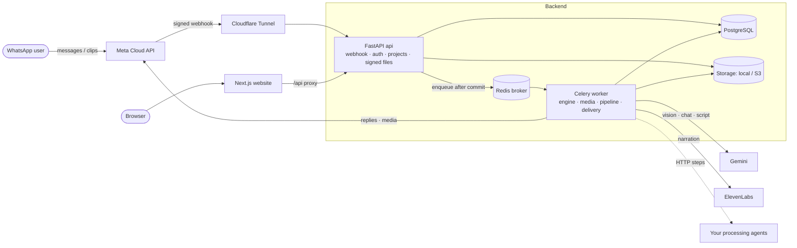
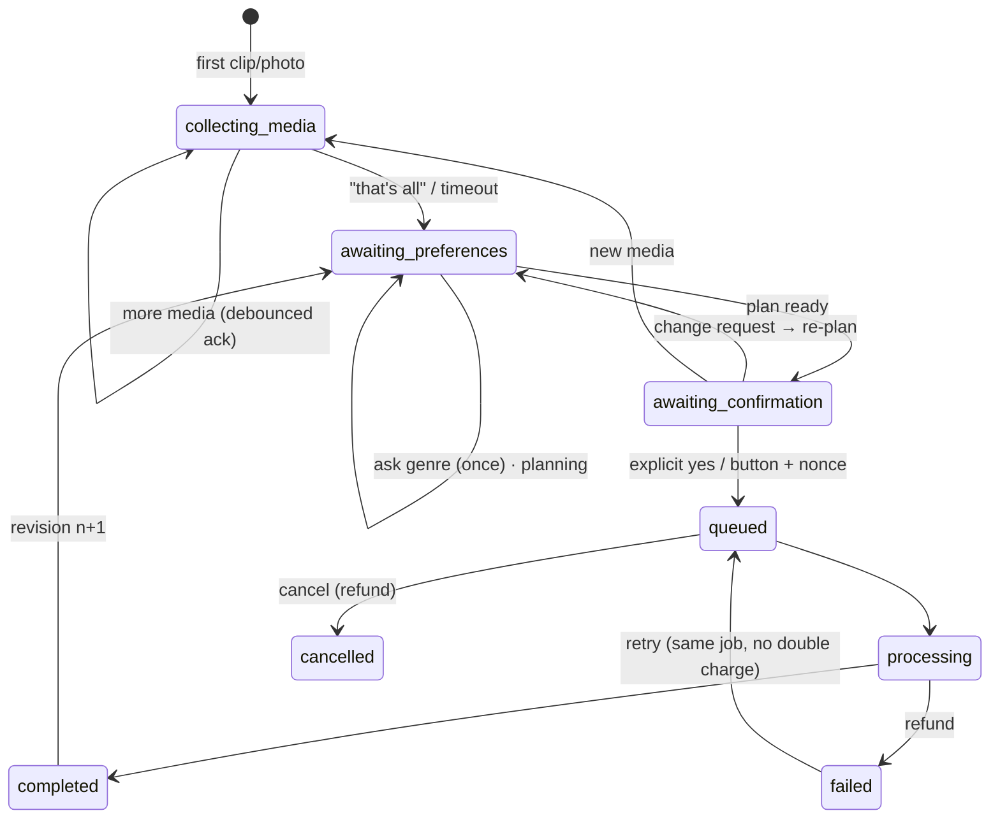
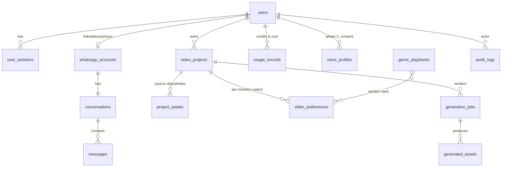

# Architecture

Modular monolith: one FastAPI codebase deployed as **api** and a **Celery worker**, plus Next.js, PostgreSQL,
Redis and object storage.



## Request path
1. Meta calls `POST /api/webhooks/whatsapp`. The API checks `X-Hub-Signature-256`, stores the message
   (unique `wamid` ⇒ duplicates ignored) and enqueues `process_inbound` **after the DB commit**; responds 200.
2. The worker's `ConversationEngine` locks the conversation row (one message at a time per chat), creates an
   anonymous profile for new numbers, and:
   * media → `project_assets` row + `download_asset` (stream ≤ limit, validate type/magic/codec/duration/pixels with
     sandboxed ffprobe, store under a generated key) + debounced `batch_ack` + `batch_timeout`;
   * text/voice → Gemini (or rules fallback) analysis → validated preference proposals → state transition.
3. When the batch is closed and the genre is known, `plan_project` runs the planning steps and sends the plan.
4. Explicit confirmation → `GenerationJob` (UNIQUE `project:r<revision>`) + credit reservation → `render_job`.
5. Rendering steps → validation → storage → outbox `deliver` (video ≤16 MB or signed link; template outside 24 h).

## Key decisions
| Decision | Why |
|---|---|
| Agent proposes, state machine decides | The model returns JSON only; fields are checked against closed option lists; all side effects are `tool_*` methods that re-check ownership, state, quotas, credits and idempotency. |
| Deterministic confirmation | Render needs the plan button with the current nonce or a short explicit "yes" (regex). Any preference change or new media rotates/clears the nonce. Defeats prompt injection in messages, captions and transcripts. |
| Pipeline steps are slots | `app/pipeline/registry.py`: builtin, `python:` plugin or HTTP agent per step, typed contracts, optional builtin fallback — see [PIPELINE_AGENTS.md](PIPELINE_AGENTS.md). |
| Playbooks are reviewed data | YAML files validated into frozen models, synced to `genre_playbooks` with a checksum, version recorded per plan; the agent receives them as quoted data. |
| Enqueue after commit + sweeper | Tasks are sent only if the transaction commits; every task re-reads state (idempotent); Celery `acks_late`; a beat sweeper re-sends stuck work (inbound, downloads, renders, deliveries, batch timeouts). |
| Anonymous first draft | New numbers get an anonymous `users` row with stricter quota/retention; linking via `LINK <code>` from that number merges projects into the registered account. |
| Sandboxed media | FFmpeg/ffprobe run with timeouts, CPU/memory/file-size rlimits, `-protocol_whitelist file,pipe`; worker container drops all capabilities; storage keys never use user file names. |
| 24 h window | Reels finished outside the window are `held`; an approved template is sent; the reel is released on the user's next message. |

## Conversation states


## Data model

Job/project states: `collecting_media, awaiting_preferences, awaiting_confirmation, queued, processing,
completed, failed, cancelled`.

## Code map
```
backend/app
├── api/            auth · me · projects + signed files · webhooks · dev simulator
├── agents/         base (AgentProvider) · rules (offline) · llm (Gemini, OpenAI/compatible, Anthropic)
├── conversation/   engine (state machine + tools) · preferences · plan_text · replies · safety
├── pipeline/       contracts · registry (slots) · run (plan/render) · builtin/{quality,scenes,scoring,
│                   sequencing,script,narration,captions,music,render}
├── media/          ffmpeg (sandboxed) · intake (validation) · samples (demo footage)
├── messaging/      base (interface + webhook parser) · meta_cloud · dev
├── jobs/           dispatch (enqueue-after-commit, retries) · celery_app · tasks
├── services/       accounts (anonymous/merge) · credits · outbox · audit · email
├── playbooks.py    playbook schema/loader          backend/playbooks/*.yaml   (reviewed data)
├── tts/ transcription/ storage/ providers.py config.py models.py security.py
frontend/app        landing · register/login/verify · dashboard · project · account · privacy/terms · dev simulator
```
